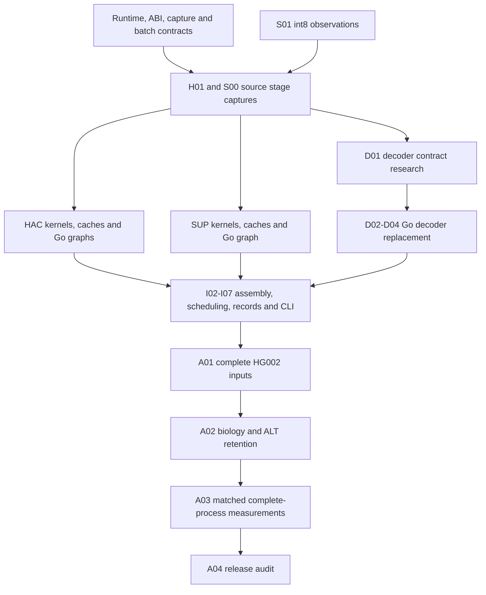

# Dispatch the remaining GPU caller cards

Read [the target and resource rules](README.md), then select cards from
[the board](CARDS.md). These are proposed assignments. This document starts no
implementation agent, producer, reservation, timed run, or merge.

## Assign the first source owners

Start distinct source owners for P01 runtime/dispatch, P05 capture contracts,
I04 input accounting, and A00 final protocols. Keep S01's frozen int8 unit intact.
Assign its next bounded runtime action only after current reservations and
admission permit it. Its source-ready state is already independently reviewed.

P01 has a native capability observation before final acceptance, so its source
draft can finish before its runtime slot. Keep that distinction visible. A native
resource delay need not block independent source work on ledgers or protocols.

Run the board checker to see which dependency-free or accepted-dependency cards
can receive a source assignment. Its output is not native admission.

```sh
jq -e -f verification/gpu-plan/check.jq docs/gpu-caller/cards.json
```

## Grow the owner pool after contracts pass

Use this table as a pool of responsibilities, not permission to start every row
at once. The exact per-card dependency graph in `cards.json` decides readiness.

| Pool | Cards | Parallel ownership |
| --- | --- | --- |
| Shared contracts | P01–P05, I01 | One ABI integrator. Separate runtime, source-capture, memory-planner, family-qualification, and batch-geometry owners. |
| Source producers | H01, S00, S01, D01 | Separate tooling owners. One admitted native producer at a time. Decoder uses retained scores. |
| HAC implementation | H02–H09 | Separate convolution, cache, fused recurrence, fallback recurrence, projection, fixed graph, and VCS files. |
| SUP implementation | S02–S14 | Separate quantization, RoPE, caches, layout, QKV, attention, linear, RMSNorm, SwiGLU, convolution, head, and graph files. |
| Decoder replacement | D02–D04 | Separate scan, beam, and quality/unpack owners after D01 establishes their contracts. |
| Caller integration | I02–I07 | Separate assembly, scheduler, ledger, metadata/capture, and writer owners. One caller/CLI integrator. |
| Final qualification | A00–A04 | Separate protocol, complete-input, biological/ALT, benchmark, and release audit responsibilities. Native timing remains exclusive. |

Kernel owners consume captured source operands directly. Candidate projection,
normalization, and SwiGLU implementations do not depend cyclically on each
other. S14 joins them in production order after their independent acceptance.
The same rule lets decoder beam and quality work use source guides/posteriors
before the candidate scan implementation is integrated.

Use fresh agents for independent reviews. Review one exact feature delta and its
receipts. Do not make every reviewer rebuild the full model or rerun all cohorts.
Only changed or invalidated producer inputs justify new producer execution.

Keep common verification entrypoints single-owner too. P05 owns caller-checker
command dispatch and registration. H01, S00, and D01 own the HAC, SUP, and decoder
checker entrypoints. Other owners submit small handler-wiring patches to them.
The ownership checker detects exact duplicate strings. Review glob and directory
overlaps manually. Validate the actual evidence and review hashes separately.

## Keep the critical path visible

This diagram groups cards for reading. `cards.json` holds the exact edges.



P04 official-family qualification and A00 prospective protocols also gate final
cohort acceptance. I04 accounting and I06 output work have source preparation
that can proceed beside model work. D01 is a research dependency, not a known
amount of coding. Opaque scratch, tie, or quality semantics can remain a blocker
even when many other cards pass.

Do not estimate seconds to completion from card count or agent count. The board
supports dozens of total assignments across waves, with review owners in
addition. This session has only four concurrent slots including the coordinator,
and the host has one coordinated native execution queue. Measure accepted units,
capture reuse, retries, elapsed time, and actual limiting resources before making
an orchestration speed claim.

## Send one complete ownership brief

Copy this brief and replace every uppercase value from the selected card. Keep
the restrictions. Give each owner a separate worktree with the dependency commits
already integrated. Raw artifacts can be shared read-only by exact pin.

```text
Own CARD_ID through implementation, verification, independent-review fixes,
and integration handoff. Do not spawn children unless separately assigned.

Read /home/jake/Projects/agent-scripts/AGENTS.MD and this repository's AGENTS.md.
Read /home/jake/.agents/skills/poteto-mode/SKILL.md and
/home/jake/.codex/plugins/cache/mcpmarket-me/pstack/0.15.30/skills/poteto-mode/SKILL.md.
Read docs/gpu-caller/README.md, DISPATCH.md, and the selected cards.json entry.

Worktree is EXACT_ABSOLUTE_WORKTREE. Base is EXACT_COMMIT_SHA.
Dependency commits and accepted receipts are EXACT_DEPENDENCIES.
You are not alone in the codebase. Preserve other agents' edits and all controls.
Own only CARD_OWNED_PATHS. Shared files are read-only. Submit a concrete interface
or integration patch to the designated ABI/caller integrator when required.

Deliver CARD_INTERFACE_AND_BUILD. Use CARD_REUSE_ARTIFACTS, checking all declared
pins before consumption. Existing accepted computation is read-only.
Run CARD_COMMANDS only after implementing commands marked to-implement.
Pass CARD_ACCEPTANCE and CARD_NEGATIVE_CONTROLS. No skipped required tests.

Initial resource grant is SOURCE_ONLY. A card is not permission for native work.
Before a native invocation, obtain direct coordination with caller-harness2 and
current caller-reference/other reservations, then fresh coordinator admission and
the original nonblocking host.lock. Do not terminate jobs or change policies.
Host-only import/replay must not run model inference or initialize a GPU.
Run a GPU consumer only through its explicitly admitted native mode.

Keep immutable raw command receipts, exits, clocks, hashes, payloads, and failures
outside Git. Repair consumers from saved output rather than repeating producers.
No stock writes, downloads outside an assigned missing-asset task, merge, deletion,
force-push, or HG005 candidate selection.

Return exact head, owned files, complete checks and outcomes, producer/consumer
pins, retained artifacts, failures, limits and next action. Do not call source-only
PASS native acceptance. A separate reviewer must audit the exact delta.
```

## Close a card from evidence

Have the independent reviewer identify the exact head, source closure, producer
identity, required tests, effective negative control, and valid comparison domain.
Record the verdict hash and immutable evidence in the card before changing its
state to accepted. Regenerate the Markdown board from JSON and rerun the checker.
Keep conditional capability-false results distinct from successful FP8 execution.

Do not merge the existing port PR or any feature PR through this procedure.
Prepare reviewable feature branches and PRs targeting `main`, or a dependency
branch while a stack is pending. Landing still needs Jake's authorization.
